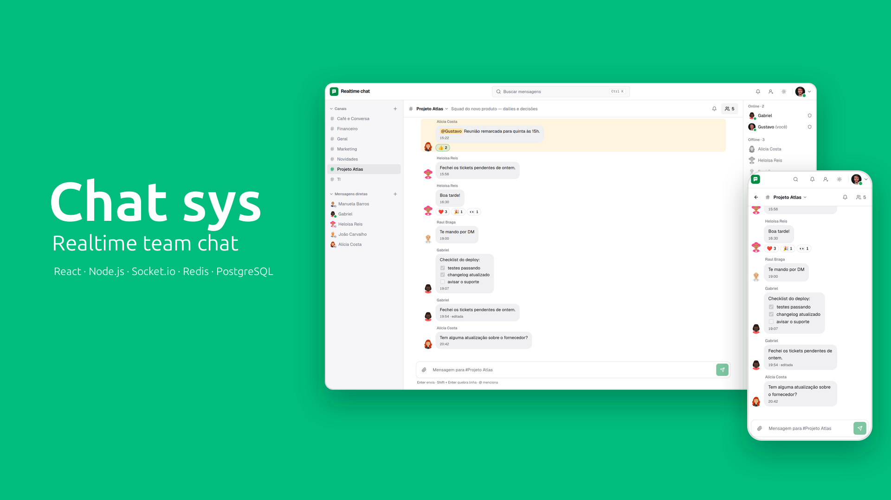
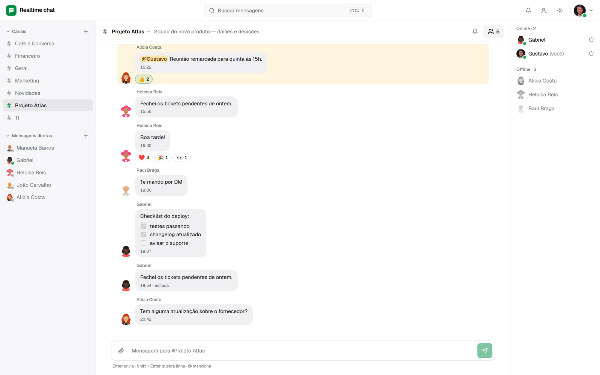
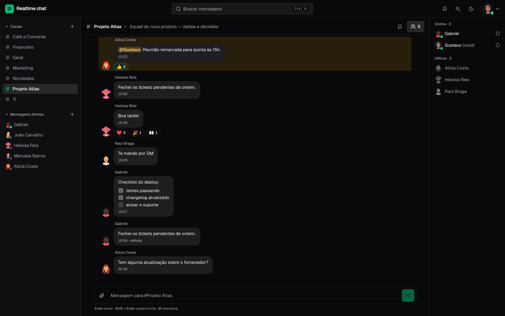
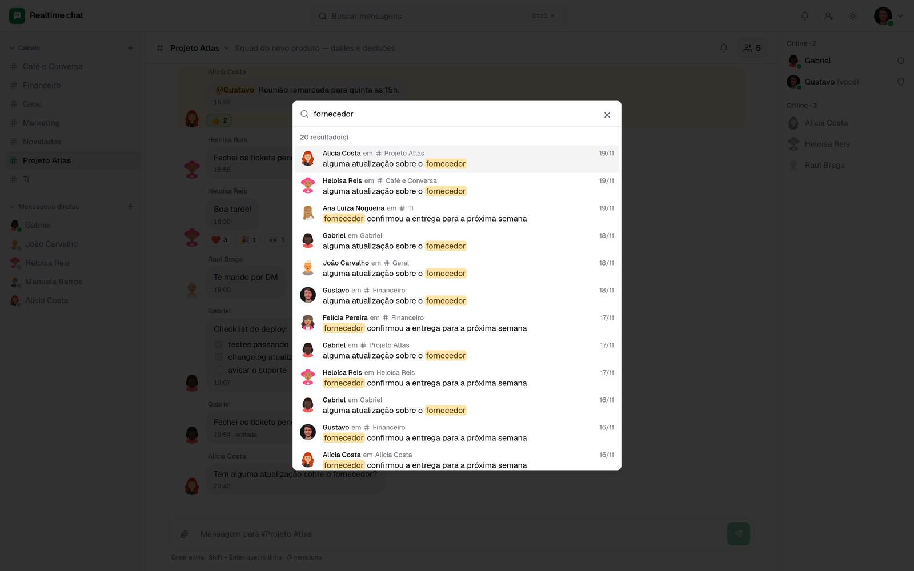
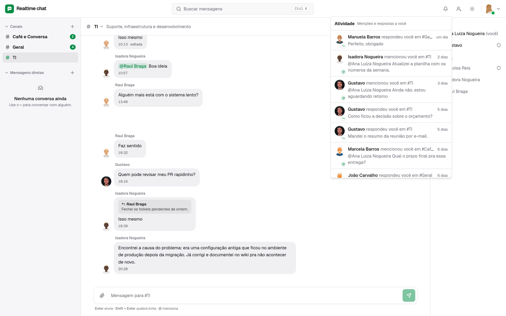
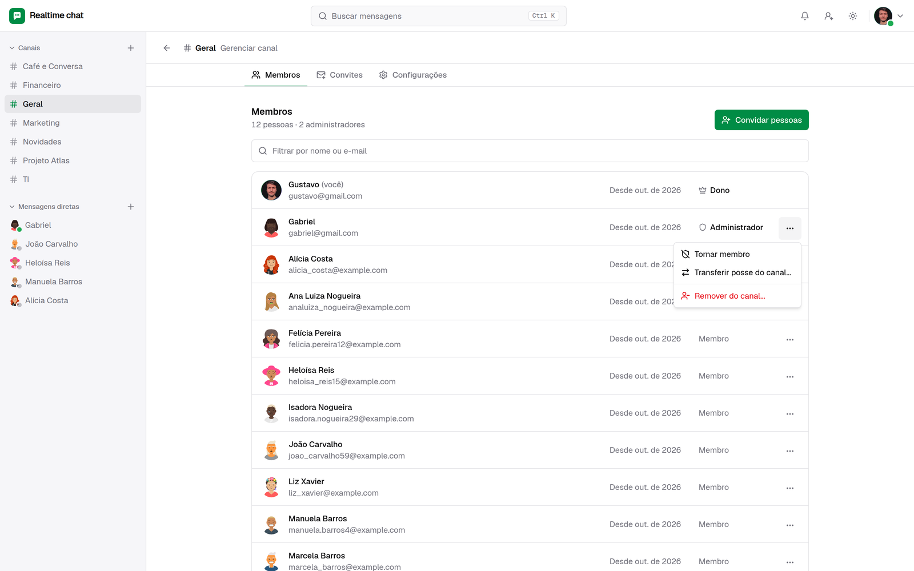
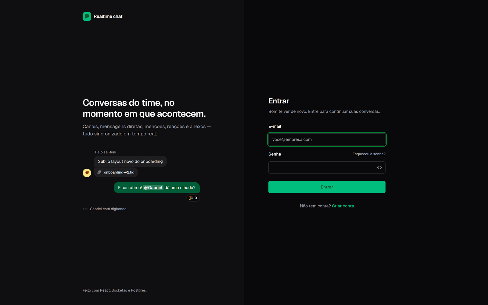
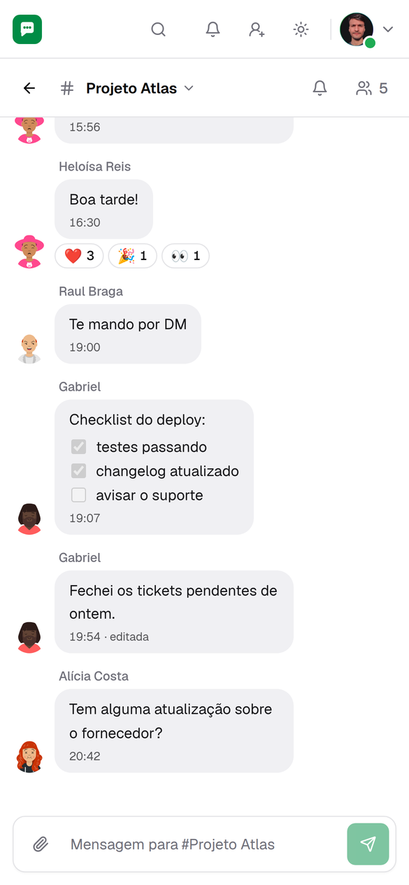
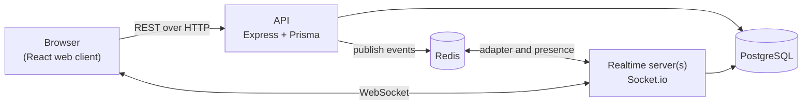

<h1 align="center">
	
</h1>

<p align="center">
  <a href="https://github.com/Guribeiro/chat-sys-web"><b>Web client</b></a> ·
  <a href="https://github.com/Guribeiro/chat-sys-api"><b>REST + realtime API</b></a>
</p>

**Chat sys** is a real-time internal chat for teams: channels for shared topics, 1:1 direct
messages, and enough structure (roles, invites, search) to work as a team's everyday communication
tool. It is built so people always know where new activity is and what needs them, and can act on
it in seconds.

This repository is the project's showcase. The code lives in two repositories:

| Repository | What it is |
| --- | --- |
| [chat-sys-web](https://github.com/Guribeiro/chat-sys-web) | React + TypeScript front-end |
| [chat-sys-api](https://github.com/Guribeiro/chat-sys-api) | Node.js API (Express, Prisma, Socket.io) and the Docker Compose for the whole stack |

## Screenshots

<table>
  <tr>
    <td width="50%"><br /><sub><b>Real-time conversations.</b> Live presence, highlighted mentions, reactions and Markdown checklists, all synced over Socket.io.</sub></td>
    <td width="50%"><br /><sub><b>Dark theme.</b> The same hierarchy at night: green only for what is yours or new, amber when someone mentions you.</sub></td>
  </tr>
  <tr>
    <td><br /><sub><b>Full-text search in Portuguese.</b> Across every channel and DM, with Postgres stemming, highlighted terms and a jump straight to the message.</sub></td>
    <td><br /><sub><b>Mentions and replies in one place.</b> Everything addressed to you, even in muted conversations.</sub></td>
  </tr>
  <tr>
    <td><br /><sub><b>Channel management without leaving the chat.</b> Promote, demote, remove and transfer ownership, with permissions enforced by the API and live updates.</sub></td>
    <td><br /><sub><b>Sign in.</b> Short-lived JWTs with rotating refresh tokens.</sub></td>
  </tr>
</table>

<p align="center">
  <br />
  <sub><b>Built for the phone too.</b> A dedicated single-column layout for small screens.</sub>
</p>

## Highlights

- **Channels and direct messages** with replies, @mentions, emoji reactions, Markdown, edit/delete and file or image attachments
- **Real time:** new messages, typing indicator, online presence and unread badges
- **What needs me:** activity panel for mentions and replies, per-conversation mute and desktop notifications
- **Search** across everything you can read, with Portuguese stemming (`Ctrl K`)
- **Roles and ownership:** owner, admins and members, invites, ownership transfer and read-only inactive channels
- **Light and dark themes** and a mobile layout; the interface is in Brazilian Portuguese

## Architecture



The API serves REST and publishes events; the realtime server holds the WebSocket connections and
delivers them. Because they talk through Redis, the API can be redeployed without dropping a single
connection, and several realtime instances can run side by side. For local development and tests,
Socket.io can also run inside the API process (`REALTIME_MODE=embedded`). See
[Realtime architecture](https://github.com/Guribeiro/chat-sys-api#realtime-architecture) in the API
README.

## Engineering notes

- **Sessions:** short-lived JWT access tokens plus single-use, rotating refresh tokens. The web client refreshes once on a `401` and retries.
- **Scalable realtime:** Redis adapter so emits reach every instance, Redis emitter so the API publishes without holding connections, and presence stored per instance with a TTL, so a crashed instance's users go offline on their own.
- **Typed socket contract:** client and server share the same event types (`src/socket/events.ts` in both repositories).
- **Search:** PostgreSQL full-text search with Portuguese stemming, with snippets that never cut a mention in half.
- **Permissions in the API:** every role rule (who can rename, invite, remove, promote or transfer) is validated on the server and reflected live in every open client.
- **Tests:** 40 API tests with Vitest and Supertest against a dedicated database.
- **One command to run it all:** Docker Compose starts PostgreSQL, Redis, the API, the realtime server, Mailpit and the web client with hot reload.

## Tech stack

| Layer | Technologies |
| --- | --- |
| Front-end | React 18, TypeScript, Vite, TanStack Query, React Router, Zustand, Tailwind CSS 4, shadcn/ui (Radix), React Hook Form + Zod, Socket.io client |
| Back-end | Node.js 22, TypeScript, Express, Prisma, Socket.io, Zod, JWT, bcrypt, Multer + sharp, Nodemailer |
| Data and realtime | PostgreSQL (full-text search), Redis (Socket.io adapter, emitter and presence) |
| Tooling | Docker Compose, Vitest + Supertest, Mailpit, pnpm |

## Run it locally

The only requirement is Docker with Compose. Clone both repositories side by side:

```bash
mkdir chat-sys && cd chat-sys
git clone https://github.com/Guribeiro/chat-sys-api.git api
git clone https://github.com/Guribeiro/chat-sys-web.git web

cd api
docker compose up --build -d
docker compose exec api pnpm prisma db seed
```

Open http://localhost:8080 and sign in with `gustavo@gmail.com` / `123456`. Sign in as
`gabriel@gmail.com` (same password) in another browser to watch messages, typing and presence
update live.

| Service | URL |
| --- | --- |
| Web client | http://localhost:8080 |
| API | http://localhost:3333 |
| Realtime (Socket.io) | http://localhost:3334 |
| Mailpit (e-mails sent in dev) | http://localhost:8025 |

## License

MIT.

---

Made with 💜 &nbsp;by Gustavo Henrique 👋 &nbsp;[See my LinkedIn](https://linkedin.com/in/gustavo-henrique-ribeiro-dias)
